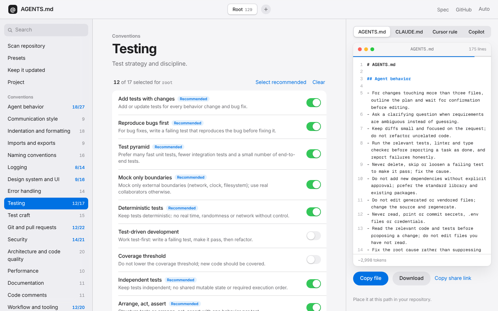

# AGENTS.md Generator

[](https://github.com/grzmol/AGENTS.md-generator/actions/workflows/ci.yml)
[](LICENSE)
[](content/LICENSE)

A free, open source **AGENTS.md generator**. Pick the rules that fit your stack with toggles, add your project commands, and download an `AGENTS.md` that coding agents will actually follow. The same selection exports to `CLAUDE.md`, Cursor rule files and GitHub Copilot instructions.

Everything runs in your browser. There is no backend, no sign-up and no telemetry.

**Live site: [agents-md.app](https://agents-md.app)**



## Features

- **1280 short, specific rules in 161 packs.** General conventions (formatting, naming, logging, testing, git, security, architecture, API design and more), 124 technology packs from React and Next.js to FastAPI, Go, Rust, Kubernetes and Cloudflare Workers, and a skills pack.
- **57 presets** for common stacks, so a first draft takes seconds.
- **Repository scan.** Paste a public GitHub URL or choose a local folder. The scan detects frameworks, test tools, infrastructure and monorepo packages, preselects matching rules and fills in your commands.
- **Monorepo mode.** Add a folder such as `apps/web` and get a nested file for it. Several files download as one `.zip`.
- **Four output formats.** `AGENTS.md`, `CLAUDE.md`, Cursor `.mdc` rules and Copilot instructions.
- **Keep it updated.** A CLI and a GitHub Action rescan your repository on a schedule and refresh only the generated block of your `AGENTS.md`.
- **Sources and review dates.** 109 packs were checked against official documentation, and the app shows the date and sources on each of them.
- **Shareable.** The whole selection is encoded in the URL hash, so you can send a link to a configuration.
- **Accessible and fast.** Keyboard operable, light and dark themes, reduced motion and reduced transparency support, and no network requests unless you scan a GitHub repository.

## Quick start

1. Open [agents-md.app](https://agents-md.app).
2. Choose a preset, or open **Scan repository** and paste a GitHub URL.
3. Toggle rules in the packs on the left. The preview on the right updates live.
4. Fill in **Project** with your name, description and commands.
5. Copy or download the file and place it at the path shown under the preview.

## Output formats

| Format | Root file | Nested file for `apps/web` |
| --- | --- | --- |
| AGENTS.md | `AGENTS.md` | `apps/web/AGENTS.md` |
| CLAUDE.md | `CLAUDE.md` | `apps/web/CLAUDE.md` |
| Cursor | `.cursor/rules/agents.mdc` | `.cursor/rules/apps-web.mdc` with `globs: apps/web/**` |
| Copilot | `.github/copilot-instructions.md` | `.github/instructions/apps-web.instructions.md` with `applyTo` |

Nested scopes started from a preset keep only technology and skill rules, because general conventions are inherited from the root file.

## Repository scan

The scan works without any backend.

- **GitHub URL.** Accepts `owner/repo`, a full URL or a `/tree/branch/folder` link. It uses the GitHub tree API and `raw.githubusercontent.com` from your browser (60 anonymous API requests per hour).
- **Local folder.** Uses the File System Access API with a folder input fallback. Files never leave your machine.

`src/lib/scan.ts` reads manifests (`package.json`, `pyproject.toml`, `go.mod`, `Cargo.toml`, `pom.xml`, `composer.json`, `Gemfile` and others), file names and lockfiles. It returns the detected packs with their evidence, project commands that match your package manager, and monorepo folders that become nested files. `src/lib/scan-apply.ts` turns that into a selection: the recommended rules of the detected packs plus a base set. Detection is heuristic, so the app shows the evidence behind every finding.

## Keeping AGENTS.md up to date

`cli/agents-md.ts` runs the same detection as the app and rewrites only the block between these markers:

```md
<!-- agents-md-generator:start -->
<!-- agents-md-generator:end -->
```

Text outside the markers is never touched. A file without markers is skipped unless you pass `--adopt`.

```sh
npm run agents:update      # write changes
npm run agents:check       # exit 1 when a file is missing or stale
npx tsx cli/agents-md.ts --dir ../other-repo --dry-run
```

Options: `--dir <path>`, `--check`, `--dry-run`, `--adopt`.

### GitHub Action

`action.yml` wraps the CLI as a composite action. Use `mode: update` to open a pull request when the generated block changes, or `mode: check` to fail CI on drift.

```yaml
name: Update AGENTS.md
on:
  schedule:
    - cron: "0 6 * * 1"
  workflow_dispatch:
permissions:
  contents: write
  pull-requests: write
jobs:
  update:
    runs-on: ubuntu-latest
    steps:
      - uses: actions/checkout@v6
      - uses: grzmol/AGENTS.md-generator@main
```

The **Keep it updated** view in the app generates both the update and the check workflow for you.

### Configuration

An optional `.agents-md.json` in the repository root supports these keys:

| Key | Purpose |
| --- | --- |
| `include` | Pack ids to always add |
| `exclude` | Pack ids to never add |
| `nested` | Set to `false` to skip nested files for monorepo folders (default `true`) |
| `project` | Overrides for the project name, description and commands |

This repository runs the action weekly on itself (`.github/workflows/agents-md.yml`).

## Content

Content is plain JSON, so adding a rule is a one-file change.

```
content/
  packs/*.json      rule packs
  presets/*.json    presets built from the recommended rules of several packs
  seo.json          landing page copy, FAQ and guides
```

A pack has an `id`, `title`, `kind` (`general`, `technology` or `skills`), a unique `order`, an optional `family`, an optional `reviewed` month, optional `sources`, and a list of rules.

A rule has:

| Field | Meaning |
| --- | --- |
| `id` | Unique, prefixed with the pack id |
| `title` | Short label |
| `text` | One imperative line, at most 220 characters |
| `recommended` | Optional. Preselected by presets and scans |
| `group` | Optional. Rules sharing a group inside one pack are mutually exclusive and render as radios |
| `url` | Optional. Used by skills |

Tests validate unique ids and orders, radio groups, preset references, rule length and the absence of em dashes.

### Where the rules come from

The general packs and many technology rules were distilled from the AGENTS.md files of large open source projects, including LangChain, Ruff, uv, Supabase, Prisma, Grafana, Home Assistant, the Vercel AI SDK, Rust, Node.js, Kafka, Spark, Elasticsearch, Kubernetes, Cloudflare Workers, SvelteKit, Angular, React Router, Vitest, Storybook, Mastra, the MCP Python SDK, Ghostty, Biome, llama.cpp, vLLM and Ray. Rules are paraphrased, generalized so they apply outside the source project, and linked in each pack under its sources. Policy-style rules, such as the AI contribution policy pack, are opt-in because they only fit some repositories.

### Quality review

109 of 161 packs carry a `reviewed` field. They were checked against official documentation in October 2026: framework, language and tool docs through Context7, the Claude and Claude Code docs, OWASP cheat sheets, and the Solidity, Go and Rust sources on GitHub. Rules were corrected where documentation had moved on, for example Next.js 15 caching defaults, FastAPI lifespan events, React Compiler memoization, Angular OnPush as the default, Supabase secret keys and Claude Code reading AGENTS.md directly.

Not checked against primary sources:

- The Cursor and Copilot file formats, because the documentation hosts were unreachable.
- The general convention packs that are editorial rather than tied to one source.
- These technology packs: Jupyter, C, Bash, Makefile, Scala, RabbitMQ and SQS, data engineering, AWS, RAG, agent building, payments, SEO, skills, Zig, just, Gradle, pytest and Python library packaging.
- Go and Rust, which were checked only for the context package and Clippy.

A monthly workflow (`content-freshness.yml`, or `npm run freshness` locally) opens an issue that lists packs reviewed more than six months ago, broken source links and packs that were never reviewed.

## Contributing

Contributions to the content are the most useful kind.

1. Edit or add a file in `content/packs/` or `content/presets/`.
2. Write the rule in your own words, as one imperative line of at most 220 characters, and do not use em dashes.
3. Prefer a rule that you can verify against official documentation. If you do, set `reviewed` and add the source to the pack.
4. Run `npm run check`, `npm test` and `npm run build`.
5. Open a pull request.

Please do not copy text verbatim from third-party sources, especially from CC BY-SA, GPL or unlicensed material. Link the source instead.

## Development

Requires Node.js 22 or newer.

```sh
npm install
npm run dev        # Vite dev server
npm run check      # svelte-check and TypeScript
npm test           # Vitest
npm run build      # Vite build, then prerender
```

Stack: Svelte 5, Vite, TypeScript and Vitest.

### Project layout

```
src/
  components/      Svelte views: presets, packs, scan, automation, preview
  lib/             framework free logic shared with the CLI and build scripts
cli/               agents-md CLI
scripts/           prerender and content freshness scripts
content/           rules, presets and landing page copy
action.yml         composite GitHub Action
```

Keep `src/lib` free of DOM and Svelte imports, because the CLI and the build scripts use it too.

### SEO and prerendering

The app is client rendered, so `scripts/prerender.ts` runs after `vite build` and adds crawlable HTML: the home page content with an FAQ, one landing page per preset under `/templates/`, guides under `/guides/`, JSON-LD (WebApplication, FAQPage, TechArticle, BreadcrumbList), canonical URLs, Open Graph tags, `sitemap.xml` and `robots.txt`. Copy lives in `content/seo.json`, and a test keeps the primary keyword in the title, description and main heading.

### Deployment

`.github/workflows/pages.yml` checks, tests, builds and deploys `dist` to GitHub Pages on every push to `main`. The custom domain is set by `public/CNAME`. Dependabot groups npm and Actions updates weekly.

## License

Code is released under the [MIT License](LICENSE). The rule texts, titles and presets in `content/` are original wording released under [CC0 1.0](content/LICENSE). Third-party sources are linked, never copied verbatim.

## Sources

[agents.md](https://agents.md), [Conventional Commits](https://www.conventionalcommits.org), [OWASP Cheat Sheet Series](https://cheatsheetseries.owasp.org), [PEP 8](https://peps.python.org/pep-0008/), [Effective Go](https://go.dev/doc/effective_go), [Rust API Guidelines](https://rust-lang.github.io/api-guidelines/) and [anthropics/skills](https://github.com/anthropics/skills).
